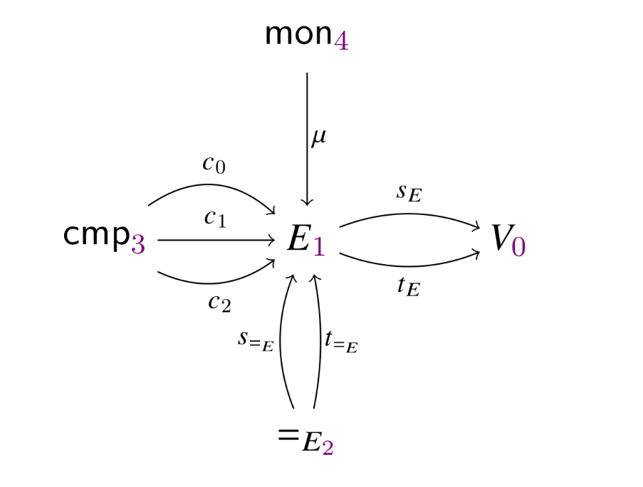

# Elpi plugins, from OCaml to Rocq: a demo

## Setup

Everything goes in a local opam switch, in `_opam/` (ignored by git). The
switch lives inside your usual opam root (`~/.opam`), and `_opam/` holds only
its packages. `_opam/` is not an opam root, so `OPAMROOT` must not point to it.
If it does, `opam env` fails with "`_opam` exists, but does not appear to be a
valid opam root". Run `unset OPAMROOT` first.

| Package | Version |
|---------|---------|
| `rocq-core` | 9.3.0 |
| `elpi`, `elpi-json`, `ppx_elpi`, `elpi-lsp` | 4.1.1 |
| `rocq-elpi`, `rocq-elpi-lsp-shim` | 3.7.0 |
| `vsrocq-language-server`, `ocaml-lsp-server` | latest |

```sh
unset OPAMROOT   # use the default root, ~/.opam

# a switch in ./_opam
opam switch create . ocaml-base-compiler.5.3.0 --no-install
eval $(opam env --switch=. --set-switch)

# rocq-elpi-lsp-shim lets elpi-lsp check the Elpi files of rocq-elpi
# programs outside Rocq
opam repo add rocq https://rocq-prover.org/opam/released
opam install -y \
  rocq-core.9.3.0 \
  elpi.4.1.1 elpi-json.4.1.1 ppx_elpi.4.1.1 elpi-lsp.4.1.1 \
  rocq-elpi.3.7.0 rocq-elpi-lsp-shim.3.7.0 \
  vsrocq-language-server ocaml-lsp-server
```

Check that everything is there:

```sh
elpi -check-package elpi-json   # the plugin loads, its stub is up to date
rocq --version
```

### Editor (VS Code)

Each time you open a new shell, run `eval $(opam env --switch=. --set-switch)`
before `code .`, so the editor finds the language servers of `_opam/`. As
above, `OPAMROOT` must not be set to `_opam`.

- [VsRocq](https://marketplace.visualstudio.com/items?itemName=rocq-prover.vsrocq)
  for `.v` files, run by `vsrocqtop`. It reads `_RocqProject`.
- [Elpi](https://github.com/LPCIC/elpi-lang) (`gares.elpi-lang`) for `.elpi`
  files, run by `elpi-lsp`. If `elpi-lsp` is not in the `PATH`, set `elpi.bin`
  to `_opam/bin`.
- [OCaml Platform](https://marketplace.visualstudio.com/items?itemName=ocamllabs.ocaml-platform)
  for `.ml` files, run by `ocamllsp`. Choose the `_opam` switch as the sandbox.

## The demo

### 1. A plugin of Elpi: `elpi-json` and `ppx_elpi`

Open [elpi-json/src/elpi_json.ml](elpi-json/src/elpi_json.ml).

- **The data type.** `t` is `Yojson.Basic.t`. The attribute
  `[@@deriving elpi { declaration }]` makes `ppx_elpi` generate everything
  needed to use `t` as an Elpi data type:
  - the Elpi declaration of the type: `data json.` with one `symb` for each
    variant (`` `Assoc `` becomes `json.assoc`, put in the namespace `json` by
    `[@@elpi.namespace "json"]`, with the doc of `[@elpi.doc ...]`), and a
    `json.copy` predicate;
  - the conversion `t : (t, _, _) ContextualConversion.t`, which embeds an
    OCaml value into an Elpi term and reads it back;
  - the declaration added to `declaration`, so the plugin documents the type.

  `ContextualConversion.(!<) t` drops the context, and gives `json`, the plain
  conversion that the predicates use.
- **The predicates.** Each `MLCode (Pred (...))` is an Elpi predicate written
  in OCaml. Its signature, such as `In(string,"File", Out(json,"J", Out(diagnostic,"D", ...)))`,
  says how each argument is converted; the OCaml function uses Yojson
  directly. `json.from_file` sorts the keys of objects.
- **The stub.** [src/gen_stub.ml](elpi-json/src/gen_stub.ml) prints the
  documentation of the plugin,
  [elpi-json.builtins.elpi](elpi-json/elpi-json.builtins.elpi). 


### 2. Plain Elpi

[demo/monicity_data.json](demo/monicity_data.json) describes this schema: each
object has an index, and each morphism a source and a target.



[demo/demo.elpi](demo/demo.elpi) accumulates `"+elpi-json/utils"`, which
loads the plugin and gives `json.lookup`. Its function `schema` returns the
names of the objects and the morphisms as `Source --(Name)--> Target`, by
matching the json terms (`json.assoc`, `json.list`, `json.string`).
`pp-schema` lays them out as a `std.fmt` document: an `hov` box for the
objects (it wraps after a comma when the line is too long) and a `v` box with
one morphism per line. `std.fmt->string` renders it:

```sh
cd demo
elpi -exec main demo.elpi
```

```
objects: =_E, E, V, cmp, mon
morphisms:
  cmp --(c₀)--> E
  cmp --(c₁)--> E
  cmp --(c₂)--> E
  E --(s_E)--> V
  =_E --(s_{=_E})--> E
  E --(t_E)--> V
  =_E --(t_{=_E})--> E
  mon --(μ)--> E
```

The `subscripts` helper renames `c_0`, `c_1`, `c_2` to `c₀`, `c₁`, `c₂` with
`json.copy`. `ppx_elpi` generated that predicate (it is in the stub), and it
copies a json value by calling `string.copy` on each string, keys included.
The ad hoc clauses, such as `string.copy "c_0" "c₀"`, are given with `=!=>`,
which adds each one with a cut. They are tried before the default
`string.copy X X`, so only these strings change.

Open `demo.elpi` in VS Code. `elpi-lsp` type checks it against the stub
of `elpi-json`, so hovering `json.lookup` or `json.assoc` shows its type and
doc. The OCaml code is not loaded for this. To see what the server sees from
the terminal, run `elpi-lsp -debug demo/demo.elpi`.

### 3. Rocq-Elpi

[demo/rocq/demo.v](demo/rocq/demo.v) reads the same file from a Rocq document, and
turns the schema into two inductive types instead of printing it. Its Elpi
code is in [demo/rocq/demo_rocq.elpi](demo/rocq/demo_rocq.elpi):

```coq
From demo Extra Dependency "monicity_data.json" as monicity_json.
From demo.rocq Extra Dependency "demo_rocq.elpi" as demo_rocq.

Elpi Command demo.
Elpi Accumulate File demo_rocq.
```

Both files become dependencies of `demo.v`. The build system can see
them, and the program names them by an identifier, not by a path. In Elpi,
`coq.extra-dep "monicity_json" (some File)` gives back the path, and
`json.from_file` reads it. The plugin is the same as in plain Elpi:
`accumulate "+elpi-json/utils"` loads it in Rocq too, and no
`Declare ML Module` is needed. We do not use rocq-elpi's json app either.

Names such as `=_E` or `s_{=_E}` are not Rocq identifiers, so `sanitize`
renames them with the same `json.copy` trick as in plain Elpi:
`string.copy "=_E" "eq_E"` and so on, given with `=!=>` (`c_0` still becomes `c₀`, a
valid identifier). Then `objects-decl` and `edges-decl` build the
declarations, `coq.typecheck-indt-decl` checks them, and `coq.env.add-indt`
adds them. The constructors of `edges` find the objects with `coq.locate`:

```sh
rocq compile -R demo demo demo/rocq/demo.v
```

```coq
Inductive objects : Set :=
    eq_E : objects
  | E : objects
  | V : objects
  | cmp : objects
  | mon : objects.
Inductive edges : objects -> objects -> Set :=
    c₀ : edges cmp E
  | c₁ : edges cmp E
  | c₂ : edges cmp E
  | s_E : edges E V
  | s_eq_E : edges eq_E E
  | t_E : edges E V
  | t_eq_E : edges eq_E E
  | μ : edges mon E.
```

Or open `demo/rocq/demo.v` in VS Code and step to the last lines:
`Print objects` and `Print edges` show them.

The Rocq files are in their own directory, `demo/rocq/`, with an
[elpi.toml](demo/rocq/elpi.toml) that has `use = ["+rocq-elpi"]`. In VS Code,
`elpi-lsp` then checks it as Rocq would: it knows the `coq.*` APIs, the
`{{ }}` quotations (through `rocq-elpi-lsp-shim`) and the template of
`Elpi Command`. Without Rocq, it reads their stubs. They cannot stay next to `demo.elpi`:
an `elpi.toml` is the project of every file below it, and the prelude of
rocq-elpi declares its own `main` (and plain `elpi` lacks the OCaml code of
the Rocq builtins). Check it from the terminal with
`elpi-lsp -debug demo/rocq/demo_rocq.elpi`.
